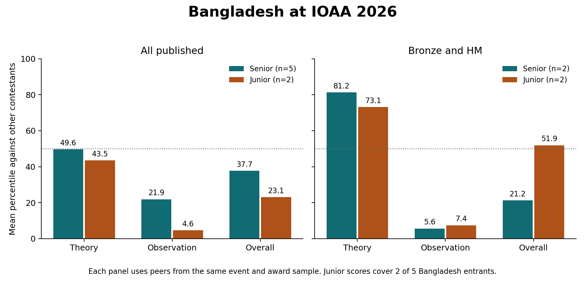
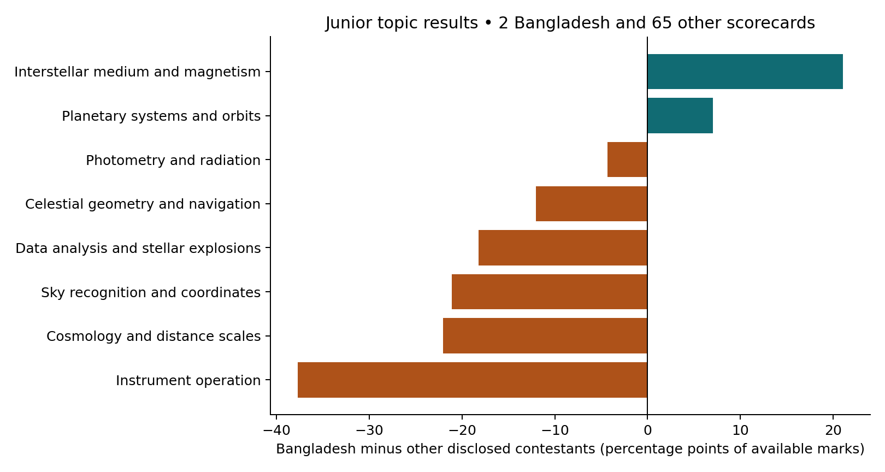
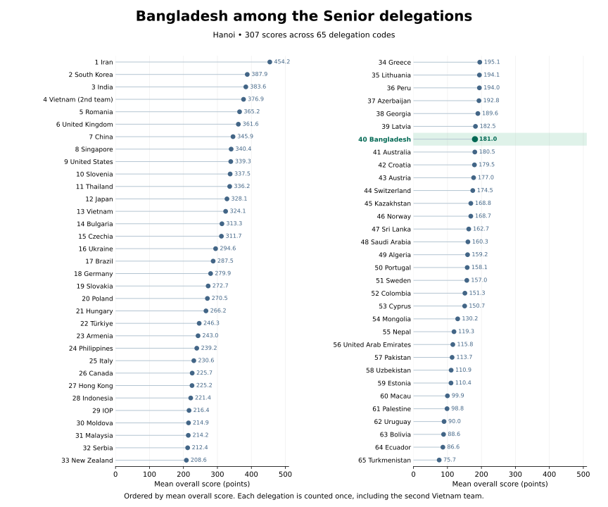
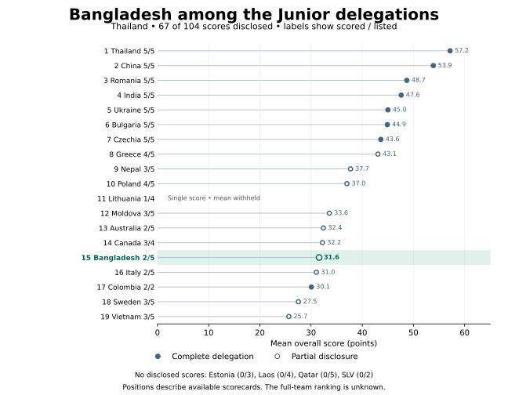

# Bangladesh at the 2026 Senior and Junior Astronomy Olympiads

Bangladesh earned one bronze and one honourable mention in each event. Theory was the stronger round relative to peers in both events. The Senior team averaged the 49.6th percentile in theory and the 21.9th in observation. The two published Junior scorecards averaged the 43.5th and 4.6th percentiles respectively. Only two of five Junior entrants are visible, so a full-team winner cannot be identified.

## How the comparison works

The Senior transcription contains 307 scored entrants across 65 delegation codes. The Junior release lists 104 entrants across 23 codes and discloses 67 scores. Of those 67, 66 have a medal or honourable mention. Every Bangladesh Senior score is available. The two Junior scorecards belong to the bronze and HM recipients. A missing row is never scored as zero.

For each Bangladesh contestant and round, count the percentage of other published contestants scoring lower, with half credit for ties. Average those percentiles across the Bangladesh students. The comparison on the right repeats the calculation using only bronze and HM recipients on both sides. Each Bangladesh pair includes one bronze and one HM. Other delegations' bronze/HM proportions can differ. Neither comparison measures the difficulty of one examination relative to the other.

| Sample and reference group | Theory | Observation | Overall |
|---|---:|---:|---:|
| Senior, all five vs 302 others | 49.6 | 21.9 | 37.7 |
| Junior, two disclosed vs 65 others | 43.5 | 4.6 | 23.1 |
| Senior bronze/HM pair vs 80 other bronze/HM | 81.2 | 5.6 | 21.2 |
| Junior bronze/HM pair vs 27 other bronze/HM | 73.1 | 7.4 | 51.9 |

Senior leads in theory under both comparisons. The observation ordering reverses, and both award pairs are below the tenth percentile in observation among bronze/HM peers. The Junior award pair stands closer to the middle of its award group overall. For an actual five-versus-five comparison, the three missing Junior scorecards matter.

## Senior preparation in Hanoi

| Component | Bangladesh mean | Other entrants' mean | Bangladesh mean percentile |
|---|---:|---:|---:|
| Theory | 66.1 | 73.5 | 49.6 |
| Data analysis | 63.0 | 76.5 | 34.0 |
| Telescope (OT) | 13.2 | 32.4 | 13.5 |
| Planetarium (OP) | 25.4 | 29.2 | 44.2 |

Among 65 delegation codes, Bangladesh placed 31st by mean theory, 59th by combined observation and 40th by overall mean. These descriptive ranks weight each entrant equally within a delegation. The field includes separate delegation codes as published.

The largest shortfall is in OT. All five Bangladesh OT marks fell below the other entrants' median of 32. OP was much closer to its peer median of 27. In the published totals, observation is OT + OP and data analysis has a separate score. The official OT exam combined observing Saturn, acquiring M29 and an echo-mapping task. A component total cannot identify which of those tasks cost marks. A timed station with points recorded separately for target acquisition, measurement and interpretation would distinguish the training needs. The same limitation applies to specific theory and data-analysis topics.

## Junior preparation in Thailand

Topics group whole problems using the source analysis's primary classifications. Each percentage equals total raw marks earned divided by total raw marks available across those problems and students. This gives a larger question more weight within its topic. The mixed-round topic groups describe raw credit rather than contributions to the weighted final score.

| Topic | Problems | Bangladesh % | Other disclosed % | Gap in percentage points |
|---|---|---:|---:|---:|
| Instrument operation | D4, D5 | 0.0 | 37.7 | −37.7 |
| Cosmology and distance scales | Q3, Q4 | 15.0 | 37.1 | −22.1 |
| Sky recognition and coordinates | D1, D6 | 45.0 | 66.1 | −21.1 |
| Data analysis and stellar explosions | Q9 | 0.0 | 18.2 | −18.2 |
| Celestial geometry and navigation | Q7, Q10, D2 | 20.7 | 32.7 | −12.0 |
| Photometry and radiation | Q1, Q2 | 62.0 | 66.3 | −4.3 |
| Planetary systems and orbits | Q6, Q8, Q11, D3 | 37.0 | 29.9 | +7.1 |
| Interstellar medium and magnetism | Q5 | 69.3 | 48.3 | +21.1 |

**Start with star hopping.** Both students earned zero on D4 and D5. Other contestants averaged 6.4/10 on D4 (star hopping) and 1.1/10 on D5 (polar alignment). The same pair of zeros therefore carries quite different information. A useful first exercise is to acquire an unfamiliar target from a chart and verify it in the eyepiece. Score polar alignment separately.

**Then test the distance-scale calculation and sky geometry.** Across Q3 and Q4 the Bangladesh mean was 3/20. Practise propagating a magnitude or redshift measurement to a physical result and checking its units and uncertainty. The Bangladesh mean was 16.5/30 on D1 sky recognition and 1.5/10 on D6 on Jupiter at opposition. A planetarium drill can distinguish recognising an object from predicting its position on a chart.

**Use Q9 as a diagnostic.** Both earned 0/25 on the expanding-photosphere problem, while the other disclosed students averaged only 4.6/25. Give the velocity extraction, graph fit and physical interpretation separate marks in training. The public totals cannot distinguish conceptual difficulty from timing or an unfinished attempt.

**Preserve strengths while checking consistency.** Both Bangladesh students exceeded the peer mean on the Martian moons problem. The pulsar rotation measure result rests on a single question. Repeat the assessment with an unfamiliar problem before treating it as a broad strength.

## Overall standing among all delegations

Bangladesh Senior placed **40th of 65 delegation codes** by average overall score (180.96/600), between Latvia (182.46) and Australia (180.54). All five Bangladesh scores are included.

Bangladesh Junior placed **15th of 19 delegations with published results** by their disclosed mean (31.58/100). Canada averaged 32.23 across three of four entrants and Italy 31.04 across two of five. Only two of Bangladesh’s five scores are available. Four of the 23 listed delegations had no published scores. The full-team ranking is unknown.

[Country standings and coverage](data/overall_standings.csv). Run `python country_plots.py` to regenerate the two standings figures.

## Regional comparison

Means are in each event's own units. Within a row the order of marks is **theory / observation / overall**. The downloadable tables include delegations with at least two disclosed scores.

| Delegation | Senior scored/listed | Senior means | Junior scored/listed | Junior means |
|---|---:|---:|---:|---:|
| Bangladesh | 5/5 | 66.1 / 38.6 / 181.0 | 2/5 | 65.4 / 29.0 / 31.6 |
| Nepal | 5/5 | 24.6 / 38.8 / 119.3 | 3/5 | 58.3 / 45.0 / 37.7 |
| India | 5/5 | 147.4 / 99.2 / 383.6 | 5/5 | 85.7 / 50.5 / 47.6 |
| Thailand | 5/5 | 116.0 / 92.0 / 336.2 | 5/5 | 107.6 / 58.2 / 57.2 |
| Vietnam (VIE/VNM) | 5/5 | 120.7 / 82.1 / 324.1 | 3/5 | 53.7 / 23.3 / 25.7 |

Bangladesh and Nepal were nearly tied in Senior observation despite Bangladesh's 41.5-mark theory lead. The two disclosed Bangladesh Juniors also averaged more theory than the three disclosed Nepal Juniors, but trailed by 16 observation marks. The latter comparison can change when the missing scores are released.

## Data, sources and reproduction

Run `python -m pip install pandas numpy matplotlib` and `python plot.py` to regenerate both graphs from the included aggregate data.

- [Round statistics](data/round_comparison.csv)
- [Delegation means and sample sizes](data/country_comparison.csv)
- [Junior country-by-topic comparison](data/country_topics.csv)
- [Bangladesh Junior topic comparison](data/topic_comparison.csv)
- [Original Senior dashboard](https://github.com/dude71828/ioaa-results-temp)
- [Original Junior analysis and topic classifications](https://github.com/AHodaeiAstro/ioaa-junior-2026-analysis)
- [Official Hanoi exam papers](https://www.ioaa2026.vn/en/past-question-paper-and-solutions)

Overall comparisons use the published totals. One Senior total in the source differs from the sum of its displayed weighted components by 0.30 points.
